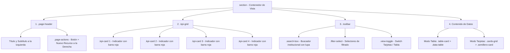

# Sistema y Modelo de Diseño Institucional UFPS (`frontend`)

Este documento define las reglas, patrones visuales y componentes del **Sistema de Diseño Institucional UFPS** para la plataforma de **Semilleros de Investigación**. Su objetivo es garantizar que cualquier desarrollador o asistente de IA mantenga una identidad visual homogénea, limpia y profesional en todas las vistas de la aplicación.

---

## 1. Identidad Visual y Tokens de Diseño

La aplicación sigue la línea gráfica institucional de la **Universidad Francisco de Paula Santander (UFPS Cúcuta)**, destacada por el uso del color rojo institucional, tipografías limpias y componentes con sombras sutiles y bordes redondeados.

### 1.1 Paleta de Colores (`variables.css`)

```css
/* Rojo Institucional UFPS */
--ufps-red-50:  #fef2f2;
--ufps-red-100: #fee2e2;
--ufps-red-200: #fecaca;
--ufps-red-500: #ef4444;
--ufps-red-600: #c4161c; /* Color primario institucional */
--ufps-red-700: #aa1916; /* Color primario hover / acento */
--ufps-red-800: #881313;
--ufps-red-900: #680e0e; /* Sidebar degradado superior */
--ufps-red-950: #420606; /* Sidebar degradado inferior */

/* Neutros y Superficies */
--bg-page:      #f8fafc; /* Fondo de la página */
--bg-surface:   #ffffff; /* Tarjetas, tablas, formularios */
--border-color: #e2e8f0; /* Bordes suaves */
--border-strong:#cbd5e1; /* Bordes de inputs y divisores */

/* Texto */
--text-primary:   #0f172a; /* Encabezados y títulos principales */
--text-secondary: #475569; /* Subtítulos, párrafos, labels secundarios */
--text-muted:     #94a3b8; /* Hints, placeholders, timestamps */
--text-on-red:    #ffffff; /* Texto sobre fondos rojos */
```

### 1.2 Tipografía y Espaciado
- **Fuente base**: Inter / Roboto / System Sans (`system-ui, -apple-system, sans-serif`).
- **Radios de borde**:
  - Botones e inputs: `var(--radius-sm)` (`6px`)
  - Tarjetas y contenedores: `var(--radius-md)` (`12px`)
  - Badges y píldoras: `var(--radius-full)` (`9999px`)
- **Sombras**:
  - Elevación de tarjetas y tablas: `var(--shadow-xs)` / `var(--shadow-sm)`
  - Modales flotantes: `var(--shadow-lg)`

---

## 2. Anatomía Universal de una Vista

Todas las vistas del sistema (`Semilleros`, `Integrantes`, `Capacitaciones`, `Otras Actividades`, `Productos`, `Grupos de Investigación`, `Líneas`, `Directores`, `Tipos de Actividad`) deben estructurarse obligatoriamente bajo el siguiente orden jerárquico:

```
<section>
  ├── 1. Encabezado de Página (.page-header)
  ├── 2. Cuadrícula de Indicadores (.kpi-grid)
  ├── 3. Barra de Herramientas y Filtros (.toolbar)
  └── 4. Área de Contenido Principal (.table-card ó .cards-grid)
</section>
```



---

## 3. Especificación de Componentes Estándar

### 3.1 Encabezado de Página (`.page-header`)
El título y subtítulo van a la izquierda; el botón de acción principal va alineado a la derecha dentro de `.page-actions`.

```html
<div class="page-header">
  <div>
    <h1 class="page-title">Capacitaciones de Investigación</h1>
    <p class="page-subtitle">Talleres formativos, cursos y sesiones de capacitación técnica organizadas por los semilleros.</p>
  </div>
  <div class="page-actions">
    <button type="button" class="btn btn--primary" id="newCapacitacionBtn">+ Nueva Capacitación</button>
  </div>
</div>
```

### 3.2 Cuadrícula de KPIs (`.kpi-grid` y `.kpi-card`)
Presenta métricas clave en tarjetas con franja roja vertical institucional (`.kpi-card::before`):
- `label`: Nombre de la métrica en mayúsculas (`.kpi-label`).
- `value`: Número o porcentaje en tamaño 1.85rem bold (`.kpi-value`).
- `hint`: Explicación contextual (`.kpi-hint`).

```html
<div class="kpi-grid">
  <div class="kpi-card">
    <span class="kpi-label">Total Capacitaciones</span>
    <span class="kpi-value">8</span>
    <span class="kpi-hint">Sesiones formativas registradas</span>
  </div>
  <div class="kpi-card">
    <span class="kpi-label">Participantes Formados</span>
    <span class="kpi-value">225</span>
    <span class="kpi-hint">Estudiantes y docentes capacitados</span>
  </div>
  <div class="kpi-card">
    <span class="kpi-label">Promedio Cumplimiento</span>
    <span class="kpi-value">91%</span>
    <span class="kpi-hint">Efectividad de sesiones</span>
  </div>
  <div class="kpi-card">
    <span class="kpi-label">Semilleros Activos</span>
    <span class="kpi-value">6</span>
    <span class="kpi-hint">Organizando capacitaciones</span>
  </div>
</div>
```

> [!TIP]
> Las tarjetas de KPI también admiten la clase `.is-clickable` e `.is-active` para actuar como filtros rápidos al hacer clic (ej. en la vista de **Integrantes** para alternar entre "Todos los integrantes" y "Solo líderes").

### 3.3 Barra de Herramientas (`.toolbar`)
Contenedor unificado para búsqueda en tiempo real, filtros y cambio de vista:
- **Buscador Institucional**: Usar siempre `.search-box` con `<span class="search-box__icon">🔍</span>` y `.search-box__input`. Nunca usar elementos SVG sin dimensiones fijas.
- **Filtros Select**: Usar `.filter-select` para menús desplegables.
- **Switch de Modo de Vista**: Usar `.view-toggle` con botones `.view-toggle__btn` que reciben `.is-active`.

```html
<div class="toolbar">
  <div class="search-box">
    <span class="search-box__icon">🔍</span>
    <input type="search" class="search-box__input" id="searchCapacitaciones"
      placeholder="Buscar por nombre, objetivo o semillero..." />
  </div>

  <select class="filter-select" id="filterSemillero">
    <option value="">Todos los semilleros</option>
    <!-- Opciones dinámicas -->
  </select>

  <div class="view-toggle" role="group" aria-label="Modo de visualización">
    <button type="button" class="view-toggle__btn is-active" data-view-mode="table">Tabla</button>
    <button type="button" class="view-toggle__btn" data-view-mode="cards">Tarjetas</button>
  </div>
</div>
```

### 3.4 Vista por Tabla Institucional (`.table-card` y `.data-table`)
Tablas limpias, con scroll horizontal adaptativo en pantallas pequeñas:
- Cabeceras en mayúsculas sutiles con alineación adecuada.
- Celda con badge de semillero (`.semillero-link-btn`) o avatar de persona (`.avatar` + `.person-cell`).
- Barra de progreso para indicadores porcentuales.
- Acciones alineadas a la derecha con `.btn--secondary.btn--sm` y `.btn--danger.btn--sm`.

```html
<div class="table-card">
  <div class="table-responsive">
    <table class="data-table">
      <thead>
        <tr>
          <th>Capacitación</th>
          <th>Semillero</th>
          <th>Fecha</th>
          <th style="width: 140px;">Participantes</th>
          <th style="width: 200px;">% Cumplimiento</th>
          <th style="text-align: right;">Acciones</th>
        </tr>
      </thead>
      <tbody>
        <tr>
          <td><strong>Taller de Deep Learning</strong></td>
          <td><button class="semillero-link-btn"><span>SIAA</span></button></td>
          <td>📅 2024-03-20</td>
          <td><span class="badge badge--member">👥 28 pers.</span></td>
          <td>
            <div style="display: flex; align-items: center; gap: 10px;">
              <div style="flex: 1; height: 8px; background: var(--border-color); border-radius: 4px; overflow: hidden;">
                <div style="width: 100%; height: 100%; background: #16a34a;"></div>
              </div>
              <strong style="color: #16a34a;">100%</strong>
            </div>
          </td>
          <td style="text-align: right;">
            <div class="card-actions" style="justify-content: flex-end;">
              <button class="btn btn--secondary btn--sm">Editar</button>
              <button class="btn btn--danger btn--sm">Eliminar</button>
            </div>
          </td>
        </tr>
      </tbody>
    </table>
  </div>
</div>
```

### 3.5 Vista por Tarjetas (`.cards-grid` y `.semillero-card`)
Grid responsivo con auto-fit (`minmax(320px, 1fr)`) que presenta:
- Cabecera con sigla UFPS destacada (`.sigla-badge`) y badge de estado o conteo.
- Título del recurso y meta información.
- Separador horizontal `.card-divider`.
- Footer con botón de previsualización `.btn--soft-red.btn--sm` y botones de acción.

---

## 4. Módulo Programático `designModel.js`

El archivo `frontend/js/ui/designModel.js` expone funciones generadoras para que las vistas no tengan que escribir HTML repetitivo:

```javascript
import {
  createPageHeader,
  createKpiCard,
  createKpiGrid,
  createToolbar,
  createViewToggle,
  createProgressBar,
} from '../ui/components.js';

// 1. Header
const headerHtml = createPageHeader({
  title: 'Mi Recurso',
  subtitle: 'Descripción institucional',
  actionButtonHtml: '<button type="button" class="btn btn--primary" id="newBtn">+ Nuevo</button>',
});

// 2. KPIs
const kpisHtml = createKpiGrid(
  createKpiCard({ label: 'Activos', value: 12, hint: 'En el sistema' }) +
  createKpiCard({ label: 'Cumplimiento', value: '95%', hint: 'Meta institucional' })
);

// 3. Toolbar
const toolbarHtml = createToolbar({
  searchId: 'searchRecurso',
  searchPlaceholder: 'Buscar...',
  filtersHtml: '<select class="filter-select">...</select>',
  viewToggleHtml: createViewToggle('table'),
});
```

---

## 5. Reglas de Oro y Anti-Patrones

> [!IMPORTANT]
> - **Nunca incluir SVGs sin dimensiones explícitas**: Evitar inyectar etiquetas `<svg>` con `width: 100%` o sin viewBox acotado dentro de contenedores flexibles, ya que genera deformaciones extremas en pantalla. Usar siempre la estructura `.search-box` con emoji o ícono delimitado.
> - **Siempre usar DTOs en el intercambio**: Toda comunicación entre el frontend y el backend debe consumir y enviar exclusivamente DTOs mapeados.
> - **Mantener el botón principal a la derecha**: Los botones de creación (`+ Nuevo ...`) deben residir obligatoriamente en `.page-actions` dentro del `.page-header`, nunca debajo del subtítulo ni flotando en el body.
> - **Persistir filtros y modos de vista**: Al escribir en los inputs de búsqueda o al cambiar de modo (`cards` ↔ `table`), preservar el foco del input y los parámetros seleccionados.
> - **Respetar los colores institucionales**:
>   - Rojo UFPS (`#c4161c` / `#aa1916`) para acciones principales, acentos de tarjeta y navegación activa.
>   - Verde (`#16a34a`) reservado para 100% de cumplimiento o estado activo exitoso.
>   - Gris azulado (`#475569` / `#0f172a`) para jerarquía de textos legibles.
